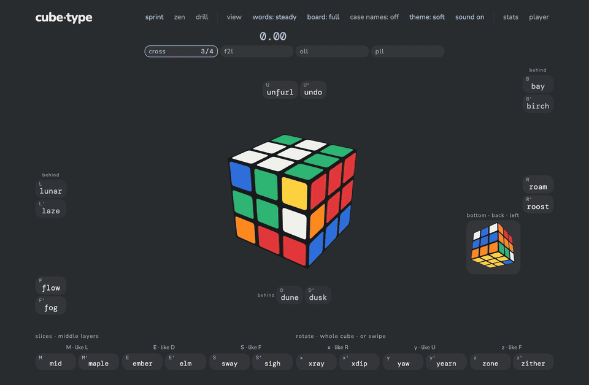
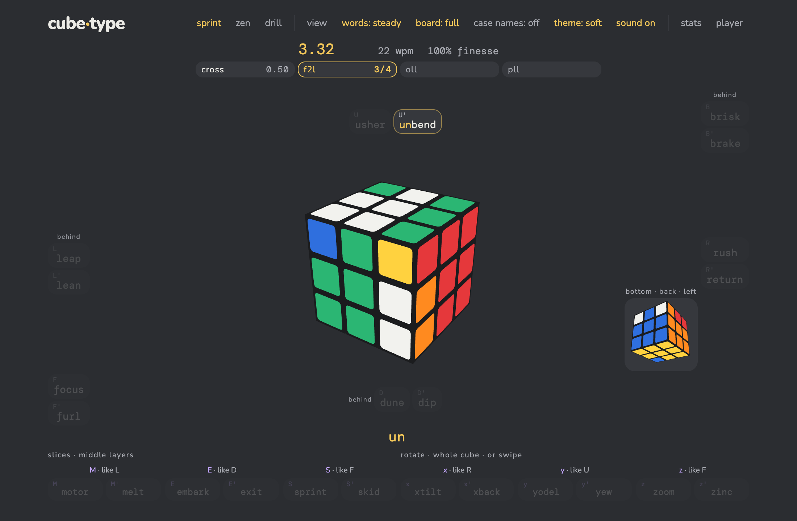
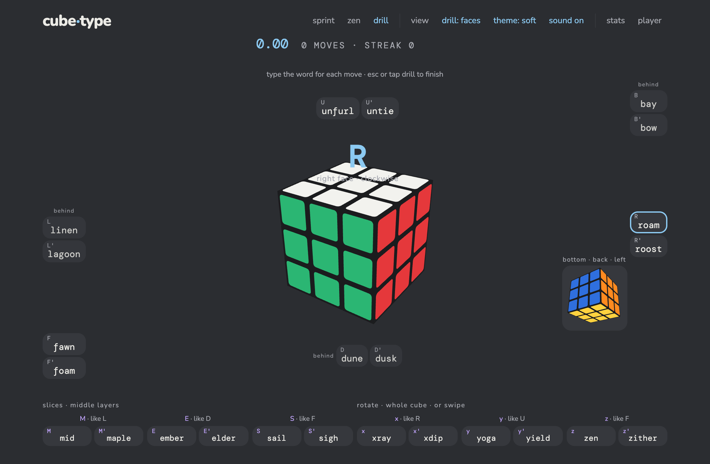
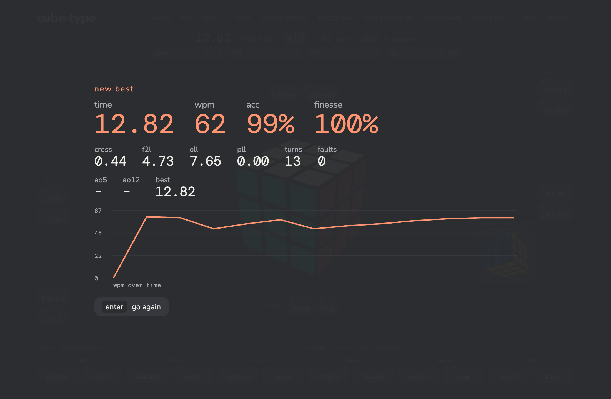

# cube·type

A browser game where you solve a Rubik's cube by typing words. Each word turns one layer.

<p align="center"></p>
<p align="center"><sub>A scripted demo solve from a set position, typed at a normal pace.</sub></p>

**Play:** https://scriblesean.github.io/cube-type/

Every move has a word, and the first letter is the face: `rush` turns R, `recoil` turns R'. Press Enter after a word to turn it again. After F2L, the game picks your OLL and PLL and shows them as a line of words, which you type like a typing test. Swipe the cube or use the arrow keys to rotate it.

<picture>
  <source media="(prefers-color-scheme: light)" srcset="docs/images/board-daylight.png">
  
</picture>

## Modes

| Mode | What you do |
| --- | --- |
| sprint | One timed solve with a split for each stage |
| zen | Cubes keep coming until you stop. Counts your solves. |
| drill | One random move at a time. Learn the words. |

<p align="center">
  
  
</p>
<p align="center"><sub>Drill, and the results card after the scripted demo solve.</sub></p>

There are six themes, two of them light. Your stats (best, ao5, ao12, splits, finesse) and profiles stay in your browser's localStorage. On a phone you can add the game to your home screen. It opens in the browser, so your stats stay with it.

## Run locally

There is no build step and there are no dependencies. Serve the folder, because ES modules don't load from `file://`:

```bash
git clone https://github.com/ScribleSean/cube-type.git
cd cube-type
python3 -m http.server 5178
```

Then open http://localhost:5178. `npm start` runs the same server.

More: [How to play](docs/how-to-play.md) · [Word picker](docs/word-picker.md) · [Finesse](docs/finesse.md) · [Development](docs/development.md)

## Contributing

Issues and pull requests are welcome. Run `npm test` before you open a PR. See [Development](docs/development.md) for the code layout.

## License

[MIT](LICENSE)
